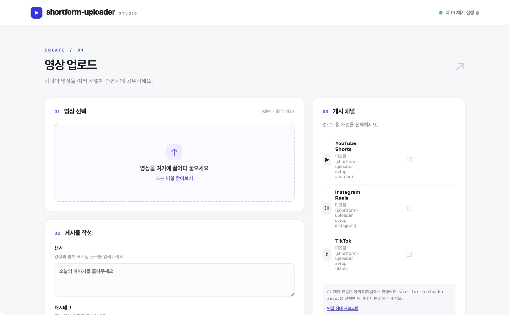

# Shortform Uploader

하나의 MP4 영상을 YouTube Shorts, Instagram Reels, TikTok에 올리는 로컬 업로드 도구입니다.



## 빠른 시작

Python 3.11 이상과 [pipx](https://pipx.pypa.io/stable/installation/)가 필요합니다. pipx로 설치하면 새 터미널에서도 가상환경을 따로 켜지 않고 실행할 수 있습니다.

```sh
git clone https://github.com/seongjooon/shortform-uploader.git
cd shortform-uploader
pipx install .
shortform-uploader gui
```

macOS에서 pipx가 없다면 먼저 `brew install pipx`와 `pipx ensurepath`를 실행하고 터미널을 다시 여세요. 다른 운영체제는 [pipx 설치 안내](https://pipx.pypa.io/stable/installation/)를 참고하세요.

1. 브라우저에서 사용할 채널의 **연결하기**를 눌러 안내에 따라 계정을 연결합니다.
2. 브라우저에 열린 화면에 MP4 영상을 놓고 검사 결과를 확인합니다.
3. 캡션과 게시 채널을 선택하고, 내용을 확인한 뒤 업로드합니다.

계정 연결에는 각 플랫폼의 개발자 앱 설정과 브라우저 로그인이 필요합니다. 연결이 끝나면 업로드 화면으로 돌아옵니다. GUI를 종료하려면 실행 중인 터미널에서 `Ctrl+C`를 누릅니다.

다음부터는 어느 폴더에서든 아래 명령으로 GUI를 열 수 있습니다.

```sh
shortform-uploader gui
```

**터미널 CLI도 사용할 수 있습니다.** `shortform-uploader`를 실행하면 터미널에서 영상 업로드를 안내하며, `shortform-uploader setup`으로 계정을 연결할 수도 있습니다. 자세한 사용법은 [업로드하기](#5-업로드하기)를 참고하세요.

> TikTok은 기본적으로 앱의 받은편지함으로 전송됩니다. 앱에서 영상을 열고 게시를 완료하세요. 직접 게시 설정과 플랫폼별 준비 사항은 아래 상세 설명을 참고하세요.

---

## 목차

1. [설치](#1-설치)
2. [개발자 앱 준비](#2-개발자-앱-준비) (플랫폼별 1회)
3. [인증 정보 등록](#3-인증-정보-등록)
4. [계정 연결](#4-계정-연결)
5. [업로드하기](#5-업로드하기)
6. [결과 확인과 재시도](#6-결과-확인과-재시도)
7. [문제 해결](#7-문제-해결)
8. [개발자용](#8-개발자용)

---

## 1. 설치

필요한 것: **Python 3.11 이상**. 런타임 의존성은 표준 라이브러리뿐입니다.

### 권장: pipx로 설치

```sh
git clone https://github.com/seongjooon/shortform-uploader.git
cd shortform-uploader
pipx install .
shortform-uploader gui
```

pipx는 앱을 별도 환경에 설치하고 실행 명령을 PATH에 연결합니다. 명령을 찾을 수 없다면 `pipx ensurepath`를 실행하고 터미널을 다시 열어 주세요. `pipx`를 설치하는 방법은 [공식 설치 안내](https://pipx.pypa.io/stable/installation/)를 참고하세요.

### 대안: 프로젝트 가상환경

pipx를 사용하지 않는다면 저장소 폴더에서 다음과 같이 설치할 수 있습니다.

```sh
python3.11 -m venv .venv
source .venv/bin/activate
python -m pip install -e .
shortform-uploader gui
```

이 방식은 실행 명령이 `.venv/bin`에 설치됩니다. 새 터미널에서는 프로젝트 폴더에서 `source .venv/bin/activate`를 다시 실행해야 합니다. GUI를 닫으려면 실행 중인 터미널에서 `Ctrl+C`를 누릅니다. 브라우저가 자동으로 열리지 않으면 터미널에 표시된 주소를 직접 입력하세요.

**선택:** `ffprobe`(FFmpeg에 포함)가 있으면 영상 길이·해상도·fps를 표시하고 플랫폼 규격도 미리 검사합니다.

```sh
brew install ffmpeg   # macOS
```

없어도 동작하지만, 규격 검사를 건너뛴다는 경고가 나옵니다.

---

## 2. 개발자 앱 준비

각 플랫폼에 **본인 개발자 앱**을 한 번 만들어야 합니다. 이 CLI는 앱 생성이나 심사 신청을 대신하지 않습니다.
쓰지 않을 플랫폼은 건너뛰어도 됩니다.

> **터미널에서 연결하려면 다음 명령을 실행하세요.**
>
> ```sh
> shortform-uploader setup
> ```
>
> 2~4단계 전체를 한 단계씩 같이 진행합니다.
> - 필요한 페이지를 자동으로 열고, 붙여 넣을 값은 클립보드에 복사해 둡니다.
> - 입력한 값을 바로 검사하고, 틀리면 무엇을 고쳐야 하는지 알려 준 뒤 다시 묻습니다.
> - 연결에 실패하면 원인을 진단하고 해결될 때까지 다시 시도하게 합니다.
> - 막히면 `?`(도움말), 페이지를 다시 열려면 `o`, 나중에 하려면 `q`. 다음 실행 때 멈춘 곳부터 이어집니다.
>
> 아래 내용은 직접 하고 싶은 사람을 위한 참고 자료입니다.

### YouTube

1. [Google Cloud Console](https://console.cloud.google.com/)에서 프로젝트를 만들고 **YouTube Data API v3**를 활성화합니다.
2. OAuth 동의 화면을 설정합니다. 앱이 *Testing* 상태라면 업로드할 Google 계정을 **테스트 사용자**로 추가합니다.
3. 사용자 인증 정보 → **OAuth 클라이언트 ID → 데스크톱 앱**을 만들고 `client_id`, `client_secret`을 받아 둡니다.

> 검증받지 않은 앱으로 올린 영상은 Google 정책에 따라 비공개로 제한될 수 있습니다.

### Instagram

필요한 것: **프로페셔널(비즈니스/크리에이터) Instagram 계정**과 **Facebook 페이지**.

1. [Meta for Developers](https://developers.facebook.com/)에서 앱을 만들고 **Facebook Login for Business**를 추가합니다.
2. 권한 `instagram_basic`, `instagram_content_publish`, `pages_read_engagement`, `pages_show_list`, `business_management`를 추가합니다.
3. 로그인 구성(Configuration)을 만들고 **`config_id`**를 받아 둡니다.
4. 유효한 OAuth 리디렉션 URI를 등록합니다. 예: `http://localhost/`
5. **Instagram 계정을 Facebook 페이지에 연결합니다.** (가장 많이 막히는 단계)
   - Facebook에서 **페이지 계정으로 전환** → 설정 → *연결된 계정(Linked accounts)* → Instagram → **계정 연결**.
   - Meta 계정 센터에 둘 다 들어 있는 것만으로는 부족합니다. 페이지 설정에서 직접 연결해야 합니다.
   - Instagram 계정이 이미 다른 페이지에 연결되어 있으면 "Switch Page"를 고르면 옮겨집니다.

### TikTok

1. [TikTok for Developers](https://developers.tiktok.com/)에서 앱을 만들고 **Login Kit**과 **Content Posting API**를 추가합니다.
2. Content Posting API의 **Direct Post** 스위치를 켜고, Scope에 `user.info.basic`, `video.upload`, `video.publish`가 있는지 확인합니다.
   (`video.publish`는 Direct Post를 켜야 목록에 나타납니다.)
3. 아직 심사받지 않은 앱이라면 **Sandbox**를 만들어야 합니다.
   - Sandbox에도 Login Kit, Content Posting API를 따로 추가하고 Redirect URI를 등록합니다.
   - Sandbox → *Target users*에 업로드할 TikTok 계정을 추가합니다.
   - **Sandbox의 client key / client secret은 Production과 다릅니다.** Sandbox 화면의 값을 쓰세요.
4. Redirect URI는 **HTTPS 주소**여야 하고, 인증할 때 **등록한 값과 한 글자도 다르지 않아야** 합니다.
   실제 서버는 필요 없습니다. 리디렉션된 주소창의 URL만 복사해 오면 됩니다.

> TikTok 심사(audit) 전에는 바로 게시한 영상이 **나만 보기**로 제한될 수 있습니다.
> 오류 `unaudited_client_can_only_post_to_private_accounts`가 나면 TikTok 계정을 비공개로 바꾸거나 `privacy = "inbox"`를 쓰세요.

---

## 3. 인증 정보 등록

2단계에서 받은 앱 정보를 **저장소 밖** `~/.config/shortform/credentials.json`에 적습니다.
쓰지 않는 플랫폼 항목은 지워도 됩니다.

```json
{
  "youtube": {
    "client_id": "YOUR_CLIENT_ID.apps.googleusercontent.com",
    "client_secret": "YOUR_CLIENT_SECRET"
  },
  "instagram": {
    "client_id": "YOUR_META_APP_ID",
    "client_secret": "YOUR_META_APP_SECRET",
    "config_id": "YOUR_LOGIN_CONFIG_ID",
    "redirect_uri": "http://localhost/",
    "graph_version": "v24.0"
  },
  "tiktok": {
    "client_key": "YOUR_CLIENT_KEY",
    "client_secret": "YOUR_CLIENT_SECRET",
    "redirect_uri": "https://your-domain.example/tiktok/callback"
  }
}
```

```sh
mkdir -p ~/.config/shortform
chmod 600 ~/.config/shortform/credentials.json
```

- `redirect_uri`는 개발자 앱에 등록한 값과 **정확히** 같아야 합니다.
- 다른 위치를 쓰려면 환경 변수 `SHORTFORM_CONFIG_DIR`을 지정합니다.
- 이 파일과 토큰은 절대 Git에 올리지 마세요.

---

## 4. 계정 연결

`shortform-uploader setup`을 썼다면 이미 끝난 단계입니다. 직접 하려면 사용할 플랫폼만 연결합니다.
**실제 터미널에서** 실행하세요 (URL을 붙여 넣는 입력이 필요합니다).

```sh
shortform-uploader auth youtube
shortform-uploader auth instagram
shortform-uploader auth tiktok
```

| 플랫폼 | 진행 방식 |
|---|---|
| YouTube | 브라우저가 열리고, 로그인하면 자동으로 완료됩니다. |
| Instagram | 브라우저에서 승인하면 `http://localhost/?code=...`로 이동합니다(페이지는 안 열려도 정상). **주소창의 URL 전체**를 터미널에 붙여 넣습니다. |
| TikTok | 승인 후 등록한 Redirect URI로 이동합니다. **주소창의 URL 전체**를 터미널에 붙여 넣습니다. |

- 리디렉션 URL에 든 코드는 **몇 분 안에 만료되고 한 번만** 쓸 수 있습니다. 바로 붙여 넣으세요.
- 이 URL은 남에게 공유하지 마세요.

연결 상태 확인:

```sh
$ shortform-uploader accounts
YouTube Shorts: 연결됨 (계정 UC...)
Instagram Reels: 연결됨 (계정 1784...)
TikTok: 미연결 → shortform-uploader setup tiktok
```

토큰은 `~/.config/shortform/tokens/<플랫폼>.json`에 권한 0600으로 저장됩니다.
YouTube·TikTok은 만료되면 자동 갱신합니다. Instagram 토큰이 만료되거나 권한이 철회되면 `shortform-uploader auth instagram`을 다시 실행하세요.

---

## 5. 업로드하기

### 대화형 (추천)

```sh
shortform-uploader
```

| 순서 | 입력 | 참고 |
|---|---|---|
| 1 | 영상 파일을 터미널에 끌어다 놓고 Enter | MP4만 가능. 공백이 있는 경로도 됩니다 |
| 2 | 캡션 | 비워도 됩니다 |
| 3 | 해시태그 | `러닝, #run shorts` → `#러닝 #run #shorts` |
| 4 | 플랫폼 번호 | `1,3` 처럼 입력, Enter는 전체. 연결된 계정만 보입니다 |
| 5 | YouTube 제목 | YouTube를 골랐을 때만. Enter는 캡션 첫 줄(최대 100자) |
| 6 | 최종 확인 | `y`일 때만 업로드합니다 |

캡션과 해시태그는 이렇게 들어갑니다.

| 플랫폼 | 위치 |
|---|---|
| YouTube | 제목 = 5번 입력, 설명 = 캡션 + 해시태그 |
| Instagram | 릴스 캡션 = 캡션 + 해시태그 |
| TikTok | 바로 게시면 캡션 + 해시태그. `inbox`면 클립보드에 복사(앱에서 붙여 넣기) |

규격에 맞지 않는 플랫폼(예: 가로 영상의 YouTube Shorts, 180초 초과)은 이유와 함께 제외하고 나머지만 올립니다.
`Ctrl+C`로 언제든 취소할 수 있습니다.

### 설정 파일 사용 (선택)

플랫폼별 세부 옵션을 고정하고 싶으면 현재 폴더에 `shortform.toml`을 만듭니다. 있으면 자동으로 읽습니다.

```sh
cp shortform.example.toml shortform.toml
```

```toml
[platforms.youtube]
enabled = true
account_id = "UC..."        # shortform-uploader accounts에 나온 계정 ID
privacy = "private"         # private | unlisted | public
made_for_kids = false

[platforms.instagram]
enabled = true
account_id = "1784..."
share_to_feed = true

[platforms.tiktok]
enabled = false             # 쓰지 않는 플랫폼은 false
account_id = "..."
privacy = "inbox"           # inbox | public | followers | friends | private
```

- 설정 파일이 없으면 연결된 계정을 그대로 쓰고, YouTube는 **`private`**(비공개)로 올립니다.
  공개로 올리려면 설정 파일에 `privacy = "public"`을 적으세요.
- `account_id`가 연결된 계정과 다르면 그 플랫폼은 선택 목록에서 빠집니다(다른 계정에 잘못 올리는 것 방지).
- 이 파일에는 비밀값이나 토큰을 넣을 수 없습니다.

### 스크립트용 비대화형 실행

```sh
shortform-uploader run clip.mp4              # shortform.toml 사용, 플랫폼만 대화형으로 선택
shortform-uploader run clip.mp4 --only youtube,tiktok
shortform-uploader run clip.mp4 --dry-run            # 검증과 계획만 출력, 업로드 안 함
```

이 모드는 캡션을 `shortform.toml`의 `[defaults]` / 플랫폼별 값에서 가져옵니다.

---

## 6. 결과 확인과 재시도

업로드할 때마다 작업 기록(job)이 `jobs/` 폴더에 저장됩니다. 결과를 알 수 없거나 실패했으면 job ID로 확인합니다.

```sh
shortform-uploader status JOB_ID     # 원격 상태 조회 (다시 올리지 않음)
shortform-uploader retry JOB_ID      # 확정 실패한 플랫폼만 다시 올림
```

| 결과 | 의미와 대응 |
|---|---|
| 업로드 완료 | 끝. 같은 job으로 retry해도 다시 올리지 않습니다 |
| TikTok 전송 완료 (`delivery=inbox`) | TikTok 앱 받은편지함에서 게시하세요 |
| 업로드 실패 (`failed`) | 플랫폼이 거부함. 원인(인증·규격 등)을 고친 뒤 `retry` |
| 확인 필요 (`unknown`) | 서버에 도달했는지 모름. 먼저 `status`로 확인 |
| `needs_manual` | 플랫폼 앱에서 직접 확인하세요. 새로 올리면 중복될 수 있습니다 |

- 같은 영상을 `shortform-uploader`으로 다시 실행하면 **새 job**이 만들어집니다. 중복 게시를 피하려면 기존 job을 먼저 확인하세요.
- 승인 후 영상이나 문구를 바꾸면 retry는 거부됩니다.
- 기록 위치는 `--jobs-dir` 또는 `SHORTFORM_JOBS_DIR`로 바꿀 수 있습니다. 기록에 업로드 복구 URL이 들어 있으니 공유하지 마세요.

종료 코드: `0` 전부 성공(또는 확인에서 취소) · `1` 실패나 확인 필요 항목 있음 · `2` 설정·입력·검증 오류.

---

## 7. 문제 해결

| 증상 | 원인과 해결 |
|---|---|
| `shortform-uploader: command not found` | 프로젝트 폴더에서 `source .venv/bin/activate`로 가상환경을 활성화하세요. 설치하지 않았다면 [설치 순서](#1-설치)를 먼저 실행하세요. |
| `pip install` 중 "Multiple top-level packages" | 오래된 버전입니다. 최신 코드로 받아 다시 설치 |
| 선택 목록에 플랫폼이 안 보임 | `shortform-uploader accounts`로 연결 상태 확인. 설정 파일의 `account_id`가 다른지도 확인 |
| Instagram: `no Instagram professional account is linked to an accessible Facebook Page` | 2단계의 **페이지 ↔ Instagram 연결**을 페이지 설정에서 직접 하세요 |
| Instagram: OAuth 중 계정 전환 화면이 반복 | Facebook에서 페이지가 아니라 **개인 계정**으로 전환한 상태에서 인증 |
| TikTok: `error_type=redirect_uri` | `credentials.json`의 `redirect_uri`가 개발자 앱(Sandbox라면 Sandbox)에 등록한 값과 정확히 같은지 확인 |
| TikTok: `unauthorized_client` | 심사 전 앱이면 **Sandbox의** client key/secret을 쓰고, 계정을 Target users에 추가 |
| TikTok: 바로 게시했는데 나만 보기로 올라감 | 심사 전 앱의 제한입니다. 공개하려면 TikTok 앱 심사가 필요합니다 |
| TikTok: `scope_not_authorized` | Direct Post를 켠 뒤 `shortform-uploader setup tiktok`으로 다시 연결 |
| TikTok: "Maximum number of attempts reached" | 본인 확인 시도 횟수 초과로 잠긴 상태입니다. **Resend를 더 누르지 말고** 몇 시간 기다린 뒤 한 번만 다시 시도 |
| `ffprobe를 찾을 수 없어...` 경고 | 규격 검사만 건너뜀. 정확히 검사하려면 FFmpeg 설치 |
| 알림이 안 뜸 | macOS 시스템 설정 → 알림에서 *스크립트 편집기* 알림을 허용. 터미널 출력은 항상 남습니다 |
| 인증 오류(`AuthRequired`) | 토큰 만료·철회. `shortform-uploader auth <플랫폼>` 재실행 |

플랫폼 규격(사전 검사 기준):

| 플랫폼 | 조건 |
|---|---|
| 공통 | MP4, 0바이트 아님 |
| YouTube Shorts | 180초 이하, 세로 또는 정사각형 |
| TikTok | 4GB 이하, 23–60fps, 가로·세로 각각 360–4096px |

---

## 8. 개발자용

```sh
python -m pip install -e '.[dev]'
python -m pytest -q
```

- 단위 테스트는 소켓을 전역 차단하고 가짜 응답을 씁니다. 실제 앱 권한이나 게시를 검증하지 않습니다.
- 실제 계정 점검 절차: [`docs/smoke-checklist.md`](docs/smoke-checklist.md)
- 설계 문서: [`docs/prd.md`](docs/prd.md), [`docs/be-plan.md`](docs/be-plan.md)

구조:

```text
shortform/
  cli.py           명령 정의 (shortform-uploader, upload, accounts, auth, run, status, retry)
  interactive.py   대화형 업로드 (경로 인식, 캡션·해시태그, 플랫폼 선택, 알림)
  pipeline.py      job 생성·승인·실행·복구 (플랫폼별 상태 기록)
  preflight.py     업로드 전 로컬 영상 검사 (ffprobe)
  config.py        shortform.toml 검증
  auth/            OAuth 로그인과 토큰 저장
  publishers/      YouTube, Instagram, TikTok 어댑터
```

API 참고:
[YouTube resumable uploads](https://developers.google.com/youtube/v3/guides/using_resumable_upload_protocol) ·
[Instagram content publishing](https://developers.facebook.com/docs/instagram-platform/content-publishing) ·
[TikTok inbox uploads](https://developers.tiktok.com/doc/content-posting-api-reference-upload-video)
